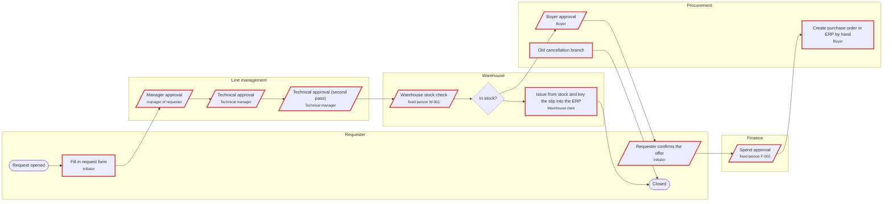

# PR-ASIS: Purchase request (As-Is)

14 steps · 11 human steps · 7 approvals · **19 findings (4 high)**

## Map

Steps with findings are outlined in red.

## Findings

| Severity | Code | Step | Finding |
|---|---|---|---|
| high | PC03 | F1 | 'Spend approval' is assigned to a fixed person |
| high | PC03 | W1 | 'Warehouse stock check' is assigned to a fixed person |
| high | PC04 | P2 | 'Requester confirms the offer' is approved by the initiator |
| high | PC08 | P3 | 'Create purchase order in ERP by hand' has no outgoing path |
| medium | PC01 | A1 | 'Manager approval' has no SLA (falls back to the platform default of 1 h) |
| medium | PC01 | A2 | 'Technical approval' has no SLA (falls back to the platform default of 1 h) |
| medium | PC01 | A3 | 'Technical approval (second pass)' has no SLA (falls back to the platform default of 1 h) |
| medium | PC01 | P2 | 'Requester confirms the offer' has no SLA (falls back to the platform default of 1 h) |
| medium | PC01 | P3 | 'Create purchase order in ERP by hand' has no SLA (falls back to the platform default of 1 h) |
| medium | PC01 | S1 | 'Fill in request form' has no SLA (falls back to the platform default of 1 h) |
| medium | PC01 | W1 | 'Warehouse stock check' has no SLA (falls back to the platform default of 1 h) |
| medium | PC01 | W2 | 'Issue from stock and key the slip into the ERP' has no SLA (falls back to the platform default of 1 h) |
| medium | PC01 | X1 | 'Old cancellation branch' has no SLA (falls back to the platform default of 1 h) |
| medium | PC02 | P1 | 'Buyer approval' has an SLA of 24 h but no escalation |
| medium | PC05 | A1 | 4 consecutive approvals: A1 -> A2 -> A3 -> W1 (limit 3) |
| medium | PC06 | A3 | 'Technical approval (second pass)' repeats the approval of 'Technical approval' (Technical manager) |
| medium | PC07 | P3 | 'Create purchase order in ERP by hand' re-keys data into another system |
| medium | PC07 | W2 | 'Issue from stock and key the slip into the ERP' re-keys data into another system |
| low | PC09 | X1 | 'Old cancellation branch' cannot be reached from the start |

## Rules triggered

- **PC01 No SLA:** A human step without its own SLA cannot be measured or escalated.
- **PC02 No escalation:** An SLA without escalation is a number nobody acts on.
- **PC03 Hard-coded assignee:** A step bound to a named person stops when that person leaves or is absent, and bypasses role-based access control.
- **PC04 Self-approval possible:** The initiator can approve their own request: segregation-of-duties breach.
- **PC05 Long approval chain:** Many consecutive approvals dilute accountability and add waiting time.
- **PC06 Repeated approver:** The same role approves twice in a row: the second approval adds delay, not control.
- **PC07 Manual re-entry:** Data typed again into another system: error risk and no traceable link.
- **PC08 Dead end:** A non-end step with no outgoing path leaves instances stuck forever.
- **PC09 Unreachable step:** A step that cannot be reached from the start is dead design.
